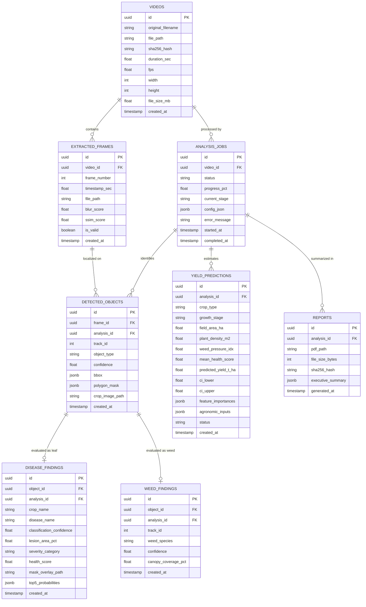

# Database Schema Design

The schema is built for PostgreSQL using SQLAlchemy 2.0. Foreign key relations ensure strong referential integrity, and cascading delete options maintain storage hygiene.

