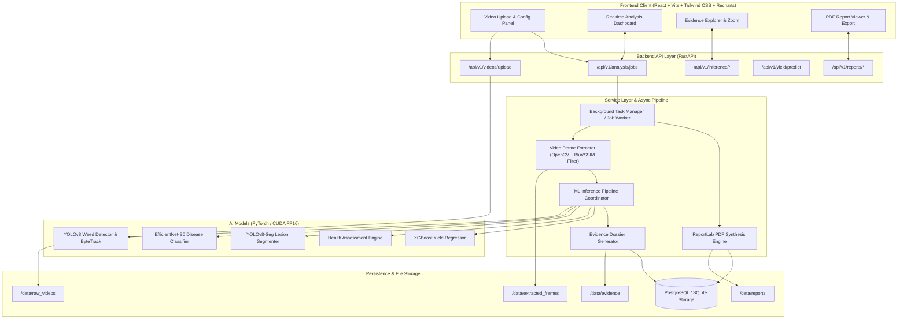

# AI-Powered Crop Monitoring, Weed Detection and Yield Prediction System
## System Architecture & Technical Specification Document

**Author:** Senior AI/ML Engineer & Full-Stack Architect  
**Project Scope:** Final-Year Engineering Project  
**Target Hardware:** NVIDIA GeForce RTX 3050 Laptop GPU (6GB VRAM, CUDA 13.1), Python 3.11+, Node.js v22+  
**Date:** October 2026

---

## 1. Requirements & Mathematical Formulations

### 1.1 Video Processing & Frame Quality Pipeline
Agricultural videos recorded via mobile devices or drones exhibit motion blur, fluctuating illumination, and redundant contiguous frames.
- **Blur Detection (Variance of Laplacian):**
  $$\text{Var}(\nabla^2 I) = \frac{1}{N} \sum_{x,y} \left( \nabla^2 I(x,y) - \mu_{\nabla^2 I} \right)^2$$
  Frames with $\text{Var}(\nabla^2 I) < \tau_{\text{blur}}$ (default $\tau_{\text{blur}} = 100.0$) are discarded as degraded.
- **Structural Similarity Deduplication (SSIM):**
  $$\text{SSIM}(x, y) = \frac{(2\mu_x\mu_y + c_1)(2\sigma_{xy} + c_2)}{(\mu_x^2 + \mu_y^2 + c_1)(\sigma_x^2 + \sigma_y^2 + c_2)}$$
  If $\text{SSIM}(F_t, F_{t-k}) > \tau_{\text{sim}}$ (default $\tau_{\text{sim}} = 0.92$), the frame is deemed redundant and skipped.
- **Temporal Traceability:**
  Every sampled frame retains exact metadata:
  $$T_f = \frac{f}{\text{FPS}_{\text{video}}}$$

### 1.2 Multi-Object Tracking & Weed Canopy Coverage
To prevent duplicate counting of the same weed across overlapping frames:
- **Tracking Algorithm:** ByteTrack with Kalman filtering for state prediction and two-stage Hungarian association using Bounding Box IoU.
- **Confirmation Threshold:** An object is confirmed as a unique weed only if tracked consistently across $\ge N_{\text{min}}$ frames (e.g., $N_{\text{min}} = 5$).
- **Weed Canopy Coverage Ratio (WCR):**
  $$\text{WCR} = \frac{\sum_{i \in \text{Weed Tracks}} \text{Area}(\text{Mask}_i \text{ or } \text{BBox}_i)}{\text{Total Field Canopy Area in Frame}} \times 100\%$$

### 1.3 Crop & Leaf Disease Classification
- **Model:** EfficientNet-B0 (pretrained on ImageNet, fine-tuned on PlantVillage + PlantDoc).
- **Softmax Probability Calibration:**
  $$P(y = c \mid \mathbf{x}) = \frac{\exp(z_c / T)}{\sum_{j} \exp(z_j / T)}$$
  Where $T$ is the temperature scaling parameter tuned on validation sets to avoid overconfident misclassifications.
- **Decoupling Confidence from Health:**
  - *Classification Confidence* = How certain the model is that the leaf exhibits Early Blight ($P = 0.94$).
  - *Health Score* = Physical biological integrity of the leaf based on tissue damage ($H = 68\%$).

### 1.4 Lesion Localization & Severity Segmentation
- **Model:** YOLOv8n-seg / MobileNetV3-UNet for leaf boundary and lesion segmentation.
- **Lesion Area Percentage:**
  $$\text{Lesion Ratio} (\%) = \frac{\sum_{(x,y)} \mathbb{I}(\text{Pixel}_{(x,y)} \in \text{Lesion Mask})}{\sum_{(x,y)} \mathbb{I}(\text{Pixel}_{(x,y)} \in \text{Leaf Mask})} \times 100\%$$
- **Health Categorization Scale:**
  | Health Category | Lesion Area % | Pathogen Weight Severity | Action Required |
  |---|---|---|---|
  | **Healthy** | $0\% - 2\%$ | $0.00$ | No intervention |
  | **Mild** | $>2\% - 10\%$ | $0.20$ | Preventive organic spray / monitor |
  | **Moderate** | $>10\% - 25\%$ | $0.50$ | Targeted fungicide/bactericide |
  | **Severe** | $>25\% - 50\%$ | $0.80$ | Immediate chemical application / isolate |
  | **Critical** | $>50\%$ | $1.00$ | Rogueing / crop loss mitigation |

- **Leaf Health Score Formula:**
  $$\text{Health Score} = \max\left(0.0, 100.0 \times \left(1.0 - \min(1.0, \frac{\text{Lesion Ratio}}{100} \times \omega_{\text{pathogen}})\right)\right)$$

### 1.5 Explainable Yield Prediction Engine
- **Model:** Gradient Boosted Regressor (XGBoost) with Random Forest ensemble.
- **Inputs:**
  $$\mathbf{X} = [\text{CropType}, \text{GrowthStage}, \text{FieldArea}_{\text{ha}}, \text{PlantDensity}_{\text{m}^{-2}}, \text{WCR}_{\%}, \overline{\text{HealthScore}}, \text{Temp}_{\text{avg}}, \text{Rainfall}_{\text{mm}}, \text{Soil}_{\text{N}}, \text{Soil}_{\text{P}}, \text{Soil}_{\text{K}}, \text{Soil}_{\text{pH}}]$$
- **Gating Mechanism:** If required agro-climatic parameters are unavailable, the model outputs `INSUFFICIENT_DATA` rather than hallucinating yield figures.
- **Uncertainty Quantification:** 90% Confidence Prediction Interval $[\hat{Y}_{0.05}, \hat{Y}_{0.95}]$ derived via Quantile Regression gradient boosting.

---

## 2. Evidence Traceability Chain

Every detection in the system satisfies strict non-repudiation and research reproducibility:
```
Raw Video (SHA-256 Hash, Resolution, Duration)
  │
  ├──► Frame (Frame Index, Timestamp in seconds, Blur Score, SSIM Check)
  │      │
  │      ├──► Detected Bounding Box / Segmented Crop Leaf (Track ID, Normalized BBox)
  │      │      ├──► Disease Classification (Crop Type, Disease Class, Calibrated Confidence)
  │      │      ├──► Lesion Segmentation (Lesion Mask Polygon, Lesion Area %, Severity Category)
  │      │      └──► Computed Health Score (Numerical 0-100 & Categorical Label)
  │      │
  │      └──► Detected Weed (Track ID, Species, Confidence, Mask/BBox Area, Frame Canopy Ratio)
  │
  └──► Video-Level Aggregation & Evidence Dossier
         ├── Evidence Storage: Original Crop, Highlighted Mask, Overlay Image
         └── ReportLab PDF Report: Dynamically compiled from immutable database records
```

---

## 3. Recommended AI Models & Datasets

| Module | Primary Model | Alternative / Fallback | Recommended Datasets | Expected Metric Target |
|---|---|---|---|---|
| **Weed Detection & Tracking** | YOLOv8n / YOLOv8s-seg + ByteTrack | YOLOv9-c + BoT-SORT | - DeepWeeds Dataset<br>- CottonWeedDet12<br>- Weed25 | mAP@0.5 $\ge 0.88$, MOTA $\ge 0.75$ |
| **Leaf Disease Classification** | EfficientNet-B0 | ResNet-50 / ConvNeXt-Tiny | - PlantVillage (54k images, 38 classes)<br>- PlantDoc (field-conditions test set) | Top-1 Accuracy $\ge 96.5\%$ |
| **Lesion Spot Localization** | YOLOv8n-seg | MobileNetV3-UNet | - PlantDoc Segmentation Set<br>- Custom Annotated Foliar Disease Masks | mIoU $\ge 0.78$ |
| **Crop Health Assessment** | Multi-Factor Agronomic Rule Engine | Deterministic Weighted Matrix | Calibrated against ICAR / FAO Foliar Disease Assessment Guides | 100% Deterministic & Transparent |
| **Yield Prediction** | XGBoost Regressor | Random Forest Regressor | - FAOSTAT Crop Yield Dataset<br>- Kaggle Indian Agriculture Production Dataset | $R^2 \ge 0.84$, $\text{RMSE} \le 0.42$ t/ha |

---

## 4. System Architecture Diagram



